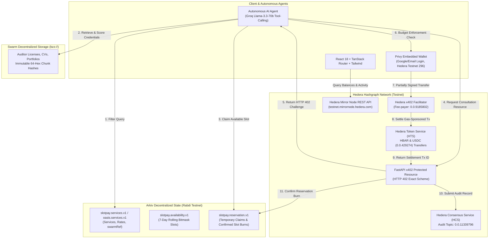

# OASIS Protocol ⸺ Open Autonomous Services & Interoperability Standard

> **Built from scratch at ETHGlobal Mumbai 2026**  
> An open, decentralized availability network and autonomous agent commerce protocol that enables services, time slots, and professional offerings to be discovered, evaluated, booked, and purchased across applications and AI agents.

---

## 🌐 Overview

**OASIS Protocol** is an open, decentralized availability network and autonomous agent commerce protocol. 

Today, professional service discovery and scheduling are fragmented across closed, proprietary platforms such as Calendly, Upwork, and Superpeer. Providers must repeatedly manage their services, rates, and availability across multiple disconnected applications, while autonomous AI agents struggle to complete real-world transactions because conventional booking systems require manual human-operated checkout flows.

OASIS solves this through a **"Publish Once, Be Discoverable Everywhere"** architecture powered by:
- **Arkiv Network**: Decentralized, queryable availability and service metadata layer on Rabdi testnet.
- **Hedera x402 & Native SDKs**: HTTP 402 machine-native micropayments with sponsored gas, paired with **Hedera Consensus Service (HCS)** for tamper-evident audit logging and **Hedera Token Service (HTS)**.
- **Swarm (`bzz://`)**: Decentralized content-addressed blob storage for immutable qualifications, verified licenses, sample code audits, and portfolios.
- **Privy**: Frictionless Web2 onboarding (Google, email) with embedded wallet chain abstraction.
- **LangGraph & Groq**: Autonomous AI booking agent executing structured discovery, Swarm document evaluation, budget enforcement, and autonomous payment.

Both human professionals and autonomous AI service agents publish their offerings, pricing, credentials, and availability to an open network. Any compatible application or autonomous AI agent can discover these services, evaluate provider qualifications, compare offerings, claim available slots, and complete payments programmatically.

---

## 🔑 Key Problems Solved

1. **Fragmented Service Discovery**: Service listings and availability are trapped within proprietary silos. OASIS makes provider-owned service and availability records publicly discoverable through Arkiv, allowing independent applications and agents to access the same network.
2. **Platform Dependency**: Providers repeatedly publish and maintain their offerings across different marketplaces. OASIS enables them to publish once and become discoverable across all compatible applications.
3. **Lack of Verifiable Provider Information**: Customers often struggle to evaluate professional qualifications across platforms. OASIS enables providers to store certificates, credentials, portfolios, and supporting documents on Swarm, with their references linked to Arkiv service entities. AI agents can retrieve and evaluate this information when comparing providers and recommending the most suitable service.
4. **Booking Coordination and Double Booking**: Multiple customers or agents may attempt to book the same slot. OASIS introduces publicly queryable temporary claims and confirmed reservation records, combined with backend concurrency controls to prevent conflicting bookings.
5. **The Agent Checkout Barrier**: Traditional booking platforms require human-operated payment flows. OASIS uses Hedera x402 to enable AI agents to discover paid services and autonomously complete payments through HTTP 402 payment challenges without human approval.

---

## 🏆 ETHGlobal Mumbai Partner Prize Integrations

| Track / Sponsor | Bounty | Integration Highlights |
| :--- | :--- | :--- |
| **Hedera**<br>AI Agents That Pay: x402 on Hedera | **$6,500**<br>(1st / 2nd / 3rd) | • HTTP 402 challenge/payment negotiation loop per Hedera exact scheme<br>• Zero-gas fee-payer model sponsored by facilitator (`0.0.9185802`)<br>• Autonomous agent evaluates budget caps & executes HBAR/USDC transfers<br>• Live testnet settlement proof with HashScan explorer verification |
| **Hedera**<br>"No Solidity Allowed": Build with Hedera SDKs | **$2,000**<br>(Up to 2 teams) | • **100% Solidity-free** architecture (zero `.sol` files)<br>• **Native Service #1 (HTS/Accounts)**: `TransferTransaction` via `hiero-sdk-python`<br>• **Native Service #2 (HCS)**: Immutable booking audit log on Topic `0.0.11339796`<br>• Hedera Mirror Node REST API integration for real-time wallet balance queries |
| **Arkiv**<br>Build on Arkiv (from scratch) | **$4,000**<br>(1st / 2nd) | • Decentralized queryable database on Rabdi Testnet (Chain ID `7794095`)<br>• Dynamic schemas: `slotpay.services.v1` (`oasis.services.v1`), `slotpay.availability.v1`, `slotpay.reservation.v1`<br>• SQL-like filtering on price, categories, duration, and provider ratings<br>• Fully documented criteria in `/arkiv/` (`schema.md`, `friction.md`, `reach.md`, `why-arkiv.md`, `how-you-use-arkiv.md`) |
| **Arkiv + Swarm Bonus**<br>Arkiv + Swarm bonus (from scratch) | **$500** | • Content-addressed blob storage (`bzz://`) for tamper-proof credentials and portfolios<br>• Entity field `swarmRef` linking live Arkiv service record to Swarm hash<br>• Browser-side `@ethersphere/bee-js` and backend Swarm Bee API integration<br>• Complete documentation and reproduction steps in `/arkiv/swarm.md` |

---

## 🏗 System Architecture



---

## 🤖 Track 1: AI Agents That Pay ⸺ x402 on Hedera ($6,500)

### Autonomous Agent Commerce Flow
OASIS turns scheduling and hiring into an autonomous, discrete request-pay-grant cycle using the official Hedera exact payment scheme:

1. **HTTP 402 Challenge**: When an agent requests a protected appointment slot at `POST /api/x402/consultation/{service_id}` or `POST /api/bookings`, the server responds with status `402 Payment Required` containing `PaymentRequirements`:
   - `scheme`: `"exact"`
   - `network`: `"hedera-testnet"`
   - `feePayer`: `"0.0.9185802"` (Official x402 facilitator account sponsoring network gas)
   - `payTo`: The provider's Hedera account ID or EVM wallet address
   - `amount`: Quoted service price in HBAR or USDC (`0.0.429274`)
2. **Autonomous Spending Controls**: The LangGraph AI buyer agent evaluates the challenge against the user's spending limit (`limit` parameter). If the price exceeds the approved cap, it raises `BudgetExceededError`, halting execution and requiring human authorization.
3. **Fee-Payer Sponsored Settlement**: The agent constructs a Hedera `TransferTransaction`, designates the facilitator as fee payer, signs the transaction with its private key, and submits the payload to the facilitator endpoint (`https://x402.org/facilitator/settle`). The facilitator attaches gas sponsorship and submits to Hedera consensus nodes.
4. **Instant Unlock**: Upon verified settlement, the API returns the booking receipt, room access link, and transaction proof.

### Qualification Checklist & Live Proofs
- [x] **x402-Protected Endpoint**: `POST /api/x402/consultation/{service_id}` (Source: [`backend/routers/x402.py`](file:///home/pranay/Projects/ethglobal-mumbai/backend/routers/x402.py)).
- [x] **Autonomous Agent Completion**: The LangGraph agent discovers providers on Arkiv, checks availability, satisfies the 402 challenge, and completes payment end-to-end with no human approval (Source: [`backend/services/agent_service.py`](file:///home/pranay/Projects/ethglobal-mumbai/backend/services/agent_service.py)).
- [x] **Settled Hedera Transaction ID**:
  - **Transaction ID**: [`0.0.9185802@1793972178.825285911`](https://hashscan.io/testnet/transaction/0.0.9185802%401793972178.825285911)
  - **Explorer Link**: [https://hashscan.io/testnet/transaction/0.0.9185802@1793972178.825285911](https://hashscan.io/testnet/transaction/0.0.9185802%401793972178.825285911)
  - **EVM Client Settlement Hash**: `0xf820241a2a20105cc136c40919b116745b222e6b4c9098bd5df2fc1ee423d73f` on Hedera Testnet (Chain ID 296).

### Extra Points Checklist
- ✅ **Spending Controls for Agents**: Strict `BudgetExceededError` thresholds in [`backend/agent/x402_hedera.py`](file:///home/pranay/Projects/ethglobal-mumbai/backend/agent/x402_hedera.py).
- ✅ **HCS Spending & Booking Audit Log**: Every completed payment submits an immutable record to Hedera Consensus Service Topic `0.0.11339796`.
- ✅ **HTS Token Support**: Supports native HBAR transfers as well as HTS token settlements (USDC token ID `0.0.429274`).
- ✅ **Mirror Node Balance Tracking**: Live account balances query `https://testnet.mirrornode.hedera.com/api/v1/accounts/{wallet}`.

---

## ⚡ Track 2: "No Solidity Allowed" ⸺ Build with Hedera SDKs ($2,000)

### 100% Native Hedera Services ⸺ Zero Smart Contracts
OASIS proves what developers can build when the Hedera network does the heavy lifting. **There is not a single Solidity smart contract in this codebase** (zero `.sol` files). All token transfers, account operations, and verifiable audit records run exclusively through native Hedera SDKs.

### Hedera SDKs Used
- **Hedera Python SDK (`hiero-sdk-python >= 0.3.0`)**: Powers the backend agent for constructing, freezing, and executing native transactions.
- **Hedera JavaScript SDK (`@hiero-ledger/sdk >= 2.90.1`)**: Used across the frontend alongside `viem` on Hedera Testnet Chain ID `296`.

### Two Native Hedera Services Implemented

#### Service 1: Hedera Token Service (HTS) & Native Accounts
- **Implementation**: [`backend/agent/x402_hedera.py`](file:///home/pranay/Projects/ethglobal-mumbai/backend/agent/x402_hedera.py) and [`frontend/src/lib/x402-hedera.ts`](file:///home/pranay/Projects/ethglobal-mumbai/frontend/src/lib/x402-hedera.ts).
- **Functionality**: Constructs atomic `TransferTransaction` payloads transferring HBAR or HTS USDC from buyer to provider account, leveraging the native Hedera fee-payer model.

#### Service 2: Hedera Consensus Service (HCS)
- **Implementation**: [`backend/services/hcs_service.py`](file:///home/pranay/Projects/ethglobal-mumbai/backend/services/hcs_service.py) and [`backend/scripts/create_hcs_topic.py`](file:///home/pranay/Projects/ethglobal-mumbai/backend/scripts/create_hcs_topic.py).
- **Functionality**:
  1. Creates an immutable audit channel on Hedera Testnet with `TopicCreateTransaction`.
  2. For every completed booking, submits a verifiable JSON audit message using `TopicMessageSubmitTransaction`:
     ```json
     {
       "app": "OASIS Protocol",
       "event": "booking_confirmed",
       "bookingRef": "SP-767972",
       "serviceId": "s1",
       "service": "UI Designer Consultation",
       "buyer": "0x5d8d26cbea05632abf3a3cf87e1f3806ad34de77",
       "amount": 0.05,
       "currency": "USDC",
       "txId": "0.0.9185802@1793972178.825285911",
       "timestamp": "2026-11-06T13:35:00Z"
     }
     ```
- **Live HCS Topic ID**: [`0.0.11339796`](https://hashscan.io/testnet/topic/0.0.11339796)
- **HashScan Topic URL**: [https://hashscan.io/testnet/topic/0.0.11339796](https://hashscan.io/testnet/topic/0.0.11339796)

### Extra Points Checklist
- ✅ **Hedera Mirror Node Integration**: [`backend/services/stats_service.py`](file:///home/pranay/Projects/ethglobal-mumbai/backend/services/stats_service.py) polls `testnet.mirrornode.hedera.com` to resolve real-time account balances and receipts.
- ✅ **Creative Use of HCS**: Tamper-evident booking receipts published to HCS give buyers and providers an unforgeable dispute-resolution record without any EVM state storage.
- ✅ **Thoughtful Security & Key Management**: Isolated per-client ECDSA key pairs (`PrivateKey.from_string_ecdsa`) prevent cross-tenant key leakage.

---

## 🧩 Track 3: Build on Arkiv (from scratch) ($4,000)

### Why Arkiv for OASIS Protocol?
Arkiv serves as the open, queryable data layer of OASIS. Providers connect their wallets and publish service profiles, offerings, pricing, and availability as wallet-owned Arkiv entities. 

A key architectural principle of OASIS is that **providers retain ownership of their published availability**. OASIS does not modify or delete provider-owned entities. Instead, the platform publishes separate reservation entities that other applications query to determine whether a slot is temporarily claimed or already booked.

### 1. Arkiv Network Configuration
- **Network**: Arkiv Rabdi Testnet
- **RPC Endpoint**: `https://rpc.rabdi.db-chain.testnet.arkiv.network`
- **Chain ID**: `7794095`
- **SDK**: `@arkiv-network/sdk` in TypeScript and native JSON-RPC `arkiv_query` in Python.

### 2. Entities & Schemas
| Schema Name | Owner Wallet | Purpose & Indexed Attributes | Expiration (TTL) |
| :--- | :--- | :--- | :--- |
| `slotpay.services.v1` (`oasis.services.v1`) | Provider Wallet | Service title, category, skills, hourly rate (`price`), duration, provider wallet, `swarmRef` | 30 days (auto-renewed by active provider) |
| `slotpay.availability.v1` (`oasis.availability.v1`) | Provider Wallet | Weekly availability bitmasks, recurring booking intervals | 7 days (rolling weekly schedule) |
| `slotpay.reservation.v1` (`oasis.reservation.v1`) | OASIS Platform | Slot reservation claims, payment transaction IDs, slot burn state | 14 days (retains proof through consultation delivery) |

### 3. Wallet Addresses That Wrote Entities
- **Platform Signer Wallet**: `0xc819c505B7Bb52ef8a77311d09526E46F8403C09`
- **Demo Provider Wallet**: `0x5d8d26cbea05632abf3a3cf87e1f3806ad34de77`

### 4. Live Query Judges Can Run
To test that Arkiv is live and returns filtered services directly from the Rabdi testnet:

```bash
curl -X POST "https://rpc.rabdi.db-chain.testnet.arkiv.network" \
  -H "Content-Type: application/json" \
  -d '{
    "jsonrpc": "2.0",
    "method": "arkiv_query",
    "params": {
      "query": "arkiv.schema = str(\x27slotpay.services.v1\x27) AND category = str(\x27Engineering\x27) AND price <= dec(50.00)"
    },
    "id": 1
  }'
```

### 5. Detailed Arkiv Documentation Files
Per the track judging criteria, all required in-depth evaluation documents are located in `/arkiv/`:
- [`/arkiv/schema.md`](file:///home/pranay/Projects/ethglobal-mumbai/arkiv/schema.md) — Comprehensive schema definitions, indexed fields, entity ownership rules, and TTL policies.
- [`/arkiv/friction.md`](file:///home/pranay/Projects/ethglobal-mumbai/arkiv/friction.md) — Developer friction points encountered and concrete improvements for the Arkiv protocol.
- [`/arkiv/reach.md`](file:///home/pranay/Projects/ethglobal-mumbai/arkiv/reach.md) — Target market, user personas, live usability, and post-hackathon roadmap.
- [`/arkiv/why-arkiv.md`](file:///home/pranay/Projects/ethglobal-mumbai/arkiv/why-arkiv.md) — Comparative analysis vs. Postgres and what data was intentionally kept off Arkiv.
- [`/arkiv/how-you-use-arkiv.md`](file:///home/pranay/Projects/ethglobal-mumbai/arkiv/how-you-use-arkiv.md) — Query filters, entity edit rights, and direct UI manifestations.

---

## 🐝 Track 4: Arkiv + Swarm Bonus ($500)

### Decentralized Credentials and Documents
OASIS uses Swarm as its decentralized file storage layer for provider credentials, certifications, licenses, and deliverables. The corresponding Swarm references are linked to provider profiles and service entities on Arkiv via the `swarmRef` attribute.

AI agents retrieve and evaluate these documents when assessing provider qualifications, comparing professionals, and recommending the most suitable service.

| Data Layer | Storage Target | Content & Privacy Model |
| :--- | :--- | :--- |
| **Arkiv** (Rabdi Testnet) | `slotpay.services.v1` | Structured, queryable metadata: hourly prices, categories, skills, availability, and on-chain booking receipts. |
| **Swarm** (`bzz://`) | Decentralized Blob Chunks | Large binary documents: provider verification certificates, audited resumes, sample penetration test reports, and deliverables. |

### Live Proofs & Links
- **Arkiv Entity Key on Rabdi Testnet**:  
  `0xcf693ae19d3fa3bbb43956a5ef7e6fe0f66c878b02a1d1347b1badf0294fb9a6`
- **Linked Swarm Reference**:  
  `96bfa8a3683f12445e999c104cf2ec700ab2f22b7a957d90d7003ffea3dc10b6`
- **Live Swarm Gateway Link**:  
  [https://api.gateway.ethswarm.org/bzz/96bfa8a3683f12445e999c104cf2ec700ab2f22b7a957d90d7003ffea3dc10b6](https://api.gateway.ethswarm.org/bzz/96bfa8a3683f12445e999c104cf2ec700ab2f22b7a957d90d7003ffea3dc10b6)
- **Postage Stamp Batch ID**:  
  `7f8a3c9b1e2d4f5a6b7c8d9e0f1a2b3c4d5e6f7a8b9c0d1e2f3a4b5c6d7e8f9a` (Purchased by: `0x5d8d26cbea05632abf3a3cf87e1f3806ad34de77`)
- **Bee Node Gateway**: `https://api.gateway.ethswarm.org`

Full Swarm documentation, video timestamps, and reproduction steps: [`/arkiv/swarm.md`](file:///home/pranay/Projects/ethglobal-mumbai/arkiv/swarm.md).

---

## 🤖 The Autonomous AI Booking Agent Workflow

OASIS provides a natural-language AI agent that connects service discovery with autonomous transactions:

```
"Find me a Python developer available tomorrow for a one-hour consultation under $20. Choose the cheapest qualified professional and book it."
```

The agent executes the following 7-step pipeline:
1. **Understand**: Extracts service requirements, budget limits, duration, and scheduling preferences.
2. **Discover**: Queries Arkiv Rabdi testnet for matching providers, rates, and open calendar bitmasks.
3. **Evaluate**: Retrieves provider credentials and portfolios from Swarm (`bzz://`) and evaluates qualifications, experience, pricing, and service suitability.
4. **Compare**: Selects the optimal provider and matching time slot.
5. **Claim**: Creates a temporary reservation record on Arkiv with a 5-minute expiration.
6. **Pay**: Completes the x402 payment through Hedera testnet within the user's authorized spending limits.
7. **Confirm**: Verifies settlement, publishes a confirmed reservation on Arkiv, records the HCS audit message, and returns the booking receipt.

---

## 🛠 Technology Stack

- **Decentralized Data**: Arkiv Network and its JavaScript SDK (`@arkiv-network/sdk`).
- **Decentralized File Storage**: Swarm for credentials, certificates, portfolios, and service documentation (`@ethersphere/bee-js`).
- **Autonomous Payments**: Hedera x402 exact scheme.
- **Blockchain Services**: Hedera Token Service (HTS) and Hedera Consensus Service (HCS) via `hiero-sdk-python` and `@hiero-ledger/sdk`.
- **Transaction Verification**: Hedera Mirror Node REST API.
- **Authentication & Chain Abstraction**: Privy with Google and email login and embedded wallets.
- **Frontend**: React 18, TanStack Start, TanStack Router, Tailwind CSS.
- **Backend**: FastAPI, Python 3.12, Uvicorn.
- **AI Engine**: Tool-calling LangGraph agent with real-time SSE streaming powered by Groq (Llama-3.3-70b-versatile).
- **Operational Database**: PostgreSQL for local concurrency controls.

---

## 🚀 Setup & Installation Guide

### Prerequisites
- **Node.js**: `>= 18.0.0`
- **Package Manager**: `pnpm` (or `bun` / `npm`)
- **Python**: `>= 3.12`
- **Python Package Manager**: `uv` (recommended) or `pip` / `venv`

---

### 1. Clone & Configure Environment

```bash
git clone https://github.com/pranay/ethglobal-mumbai.git
cd ethglobal-mumbai
```

#### Backend Environment (`backend/.env`)
Create or edit `backend/.env`:

```ini
# AI Reasoning (Groq)
GROQ_API_KEY=your_groq_api_key_here
GROQ_MODEL=openai/gpt-oss-120b

# Arkiv Rabdi Testnet
ARKIV_RABDI_RPC=https://rpc.rabdi.db-chain.testnet.arkiv.network
ARKIV_ACCESS_KEY=your_arkiv_access_key_here
ARKIV_PLATFORM_WALLET=0xc819c505B7Bb52ef8a77311d09526E46F8403C09
ARKIV_PLATFORM_PRIVATE_KEY=your_arkiv_platform_private_key_here

# Hedera x402 & Native Services
HEDERA_NETWORK=hedera:testnet
X402_FACILITATOR_URL=https://x402.org/facilitator
X402_FACILITATOR_ACCOUNT=0.0.9185802
HEDERA_USDC_TOKEN_ID=0.0.429274

# Hedera Consensus Service (HCS) Audit Topic
HEDERA_OPERATOR_ID=0.0.11328053
HEDERA_OPERATOR_KEY=your_hedera_operator_private_key_here
HEDERA_AUDIT_TOPIC_ID=0.0.11339796
```

#### Frontend Environment (`frontend/.env`)
Create or edit `frontend/.env`:

```ini
VITE_PRIVY_APP_ID=your_privy_app_id_here
PRIVY_APP_SECRET=your_privy_app_secret_here
VITE_ARKIV_ACCESS_KEY=your_arkiv_access_key_here
VITE_API_URL=http://localhost:8000
VITE_PROD_API_URL=https://ethglobal-mumbai.onrender.com
```

---

### 2. Start Backend Service

```bash
cd backend

# Install dependencies using uv
uv sync

# Run the FastAPI server
uv run uvicorn main:app --reload --port 8000
```
Backend API interactive documentation is available at: `http://localhost:8000/docs`

---

### 3. Start Frontend Application

```bash
cd frontend

# Install dependencies
pnpm install

# Start Vite development server
pnpm dev
```
Open `http://localhost:8080` in your browser.

---

### 4. Running Test Suites

```bash
cd backend
# Run all automated tests (x402 protocol, Arkiv client, AI agent reasoning, API endpoints)
uv run pytest
```

---

## 📽 Verification & Demo Walkthrough

### 1. Test Hedera x402 Micropayment Flow
1. Navigate to `http://localhost:8080/buyer` (The Autonomous Agent Interface).
2. Enter an autonomous booking prompt:  
   *"Find me a smart contract auditor under $50 and book a one-hour consultation."*
3. Watch the LangGraph agent:
   - Formulate structured Arkiv SQL-like filters.
   - Query verified providers from the Rabdi testnet.
   - Evaluate linked Swarm portfolio documents.
   - Check available calendar bitmasks.
   - Receive the HTTP 402 challenge.
   - Autonomously evaluate budget caps (`limit: $50`).
   - Settle payment via the Hedera facilitator with sponsored gas.
4. Inspect the generated HashScan transaction and verified booking receipt.

### 2. Verify HCS Audit Topic
Every booking posts an immutable audit log to Hedera Consensus Service.
- View the live message stream on HashScan:  
  [https://hashscan.io/testnet/topic/0.0.11339796](https://hashscan.io/testnet/topic/0.0.11339796)
- Or query via Hedera Mirror Node REST API:  
  `https://testnet.mirrornode.hedera.com/api/v1/topics/0.0.11339796/messages`

### 3. Verify Swarm Credential Blobs
1. Visit `http://localhost:8080/provider/portfolio`.
2. Drag and drop any credential PDF or resume into the Swarm uploader.
3. Observe the generated `bzz://` reference hash and verify openable gateway access on `https://api.gateway.ethswarm.org/bzz/<hash>`.

---

## 💡 What Makes OASIS Different?

Traditional marketplaces own the service directory, control discovery, and require customers to interact with their proprietary booking and payment systems.

OASIS introduces an open alternative:
- **Providers publish their services once and retain ownership.**
- **Independent applications can discover the same providers and availability.**
- **Credentials and professional documents are stored on decentralized infrastructure and can be retrieved by AI agents.**
- **AI agents can evaluate provider qualifications rather than relying only on text descriptions and stars.**
- **Users can onboard through familiar Google and email authentication without needing to understand blockchain wallets.**
- **Booking coordination is publicly queryable and interoperable.**
- **Payments can be executed autonomously through standardized HTTP 402 requests.**
- **Transactions have independently verifiable payment and audit records.**

OASIS is not simply another appointment-booking application. It is an open infrastructure layer connecting service providers, independent marketplaces, and autonomous AI agents.

Our vision is to make every service discoverable and purchasable on the open internet, whether the buyer is a human, an application, or an autonomous AI agent.

---

## 🤖 AI Usage Disclosure (ETHGlobal Rules)

In accordance with ETHGlobal hackathon guidelines, AI tools were utilized during the development of OASIS Protocol:
- **Groq API & Llama-3.3-70b-versatile**: Powers the in-application autonomous buyer agent logic (intent parsing, provider scoring, parameter extraction, and autonomous 402 negotiation).
- **LLM Assisted Coding**: Google Antigravity AI pair programming assistant was utilized for code scaffolding, typed schema generation, and test writing. All core architectures, x402 protocols, HCS audit logging, and Arkiv/Swarm integrations were designed and authored for ETHGlobal Mumbai.

---

## 📄 License

This repository is licensed under the [MIT License](LICENSE).
